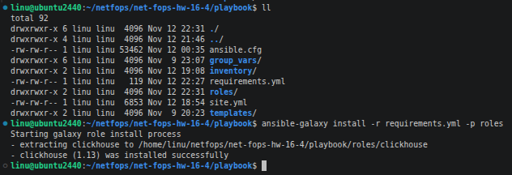
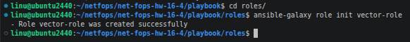
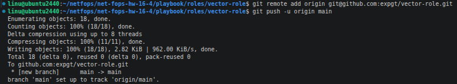
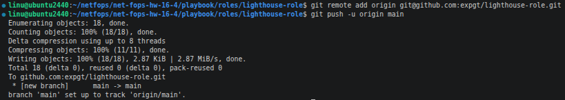

# Домашнее задание к занятию 4 «Работа с roles» - Розаев А.Ю.

## Подготовка к выполнению

1. Произведено ознакомление с [LightHouse](https://youtu.be/ymlrNlaHzIY?t=929).
2. Созданы два пустых публичных репозитория в проекте: vector-role и lighthouse-role.
3. Добавлена публичная часть ключа к профилю на GitHub.

## Основная часть

Цель — разбить playbook на отдельные roles. 

Задача — сделать roles для ClickHouse, Vector и LightHouse и написать playbook для использования этих ролей. 

Ожидаемый результат — существуют три репозитория: два с roles и один с playbook.

**Что для этого сделано**

1. Создан в старой версии playbook файл `requirements.yml` и заполнен содержимым:

   ```yaml
   ---
     - src: git@github.com:AlexeySetevoi/ansible-clickhouse.git
       scm: git
       version: "1.13"
       name: clickhouse 
   ```

2. При помощи `ansible-galaxy` скачана эта роль.



3. Создан новый каталог с ролью при помощи `ansible-galaxy role init vector-role`.



4. На основе tasks из старого playbook заполнена новая созданная role. Переменные разнесены между `vars` и `default`. 
5. Перенесены нужные шаблоны конфигов в `templates`.
6. В `README.md` описаны обе роли и их параметры.
7. Выполнены шаги 3–6 для LightHouse.





8. Все roles выложены в репозитории. Проставлены теги, используя семантическую нумерацию. Добавлены roles в `requirements.yml` в playbook.
9. Playbook переработан на использование roles, учтены зависимости LightHouse и возможности совмещения `roles` с `tasks`.

    ```yaml
    ---
    - name: Install Clickhouse
    hosts: clickhouse
    roles:
        - clickhouse

    - name: Install and configure Vector
    hosts: vector
    roles:
        - vector-role

    - name: Install and configure LightHouse
    hosts: lighthouse
    pre_tasks:
        - name: Install Nginx and unzip packages
        become: true
        ansible.builtin.apt:
            name:
            - nginx
            - unzip
            state: present
            update_cache: true

    roles:
        - lighthouse-role
    ```

10. Playbook выложен в репозиторий.
11. Ссылки на оба репозитория с roles и на репозиторий с playbook.


[vector-role](https://github.com/expgt/vector-role/tree/1.0.0)

[lighthouse-role](https://github.com/expgt/lighthouse-role/tree/1.0.0)

[playbook](https://github.com/expgt/net-fops-hw-16-4/blob/main/playbook/site.yml)

---
